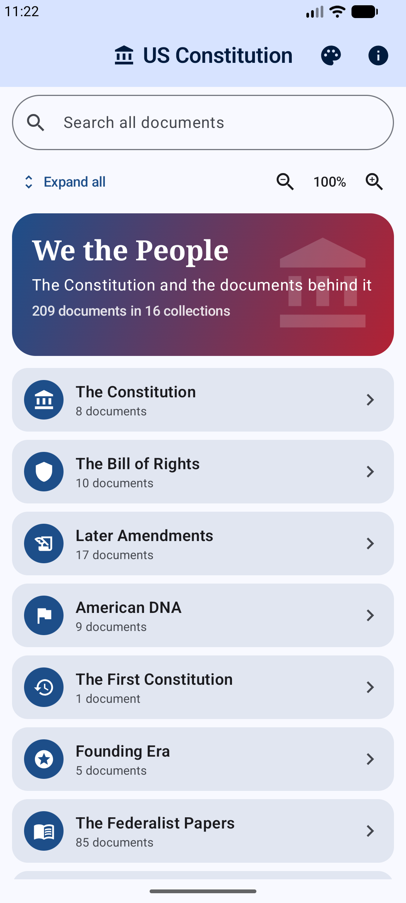
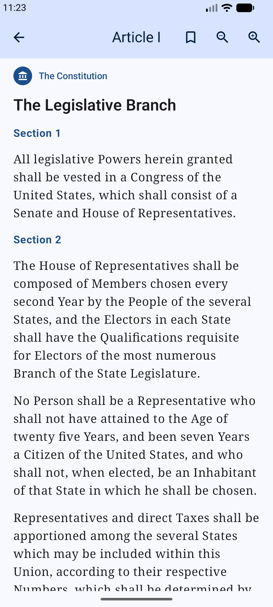
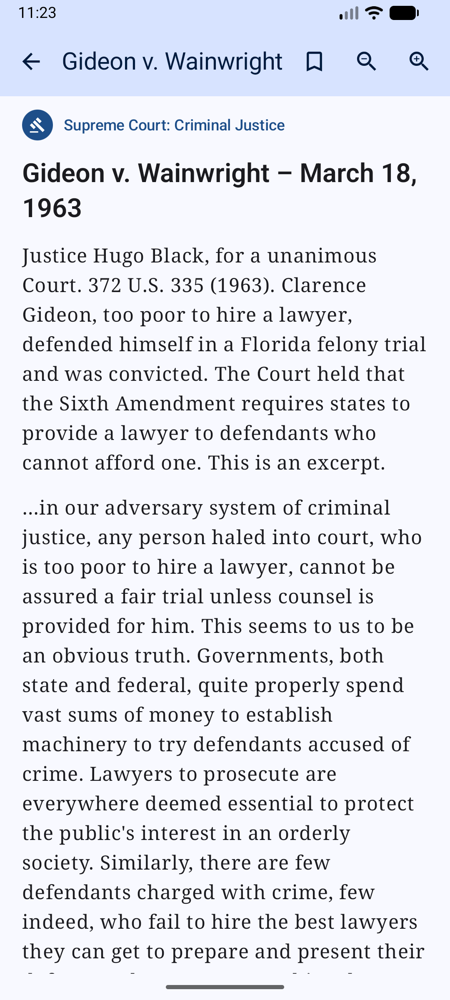
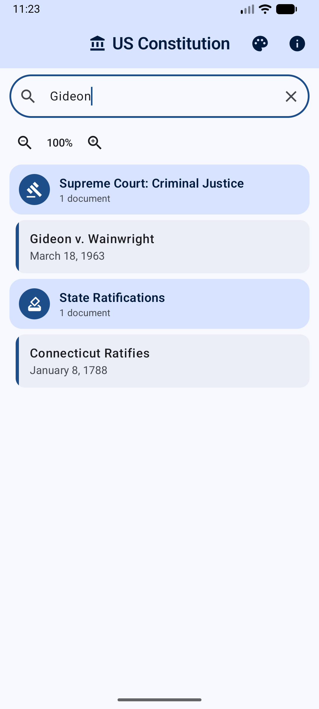
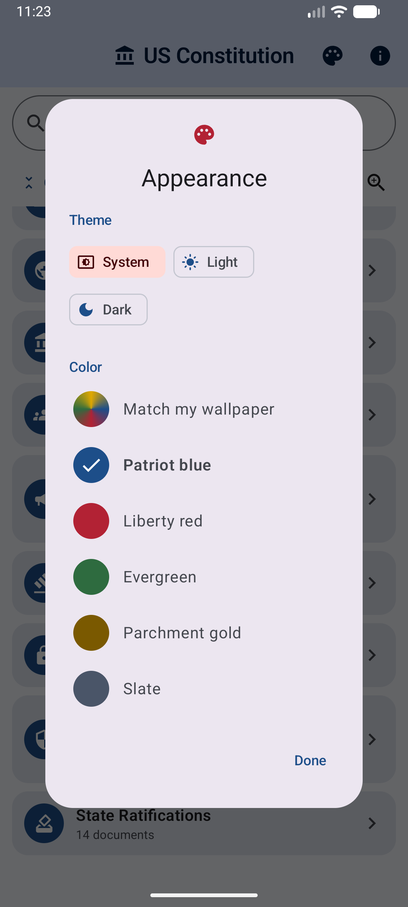
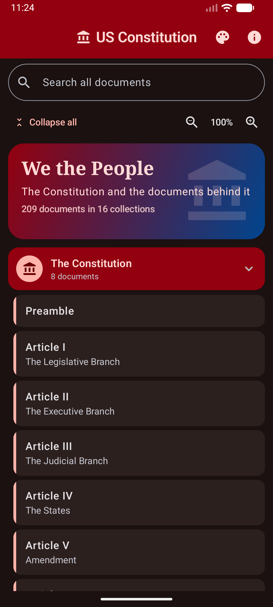

# US Constitution (Android)

A searchable reader for the Constitution of the United States and the documents behind it, built for
current versions of Android (Kotlin, Jetpack Compose, Material 3; targets Android 16, API 36;
runs on Android 8.0 and up).

**[Download the latest signed APK](https://github.com/peepsnet/USConstitutionApp/releases/latest)** (Android 8.0 or newer).

## Screenshots

<table>
  <tr>
    <td align="center"> Collections, with a banner and icons</td>
    <td align="center"> Reading Article I</td>
    <td align="center"> A Supreme Court case</td>
  </tr>
  <tr>
    <td align="center"> Search across every document</td>
    <td align="center"> Light, dark and accent colors</td>
    <td align="center"> Dark theme, Liberty red</td>
  </tr>
</table>

## What is in it

* The Constitution, the Bill of Rights and the other amendments, article by article.
* The Articles of Confederation, the Federalist Papers, the thirteen state ratifications and a timeline.
* Founding-era documents (the Declaration of Independence, the Mayflower Compact, the Great Compromise and more).
* Presidential addresses from Washington to Obama.
* Selected Supreme Court opinions, grouped by theme, with the main dissent for some.

Search, bookmarks, swipe between entries, light/dark themes with six accent colors, and a zoom
that is remembered separately for each display (useful on very large screens).

## Credit

This app is a rebuild of **"United States Constitution!"** (version 2.0.3) by **Ken Hunt**, first released
in 2009, whose layout and collection of related documents are the model for this one. The original
drew mostly on www.usconstitution.net (c) 1995-2011 Steve Mount, all rights reserved; **none of that
site's notes or annotations are used here.** The app's About screen lists the sources of every
document (Avalon Project at Yale Law School, Library of Congress, National Archives, National Park
Service, Cornell's Legal Information Institute, the American Presidency Project, the presidential
libraries and others).

## Project layout

* `app/src/main/assets/*.txt` — all of the text. Format: `@group Name` starts a group, `# Title` starts an entry,
  everything else is the entry's body. Entry titles look like `Name – Month D, YYYY`; a group whose
  titles all carry a year is shown in date order. Group names are listed in `GROUP_ORDER`
  (`Constitution.kt`) and given an icon in `groupIcon` (`Theme.kt`).
* `app/src/main/java/com/example/usconstitution/` — the app (`MainActivity.kt`, `Constitution.kt`, `Theme.kt`).
* `RELEASE.md` — how to build a signed release.

## Build

Requires JDK 17+ (Android Studio's bundled JDK works) and the Android SDK (platform 36).

    ./gradlew assembleDebug      # app/build/outputs/apk/debug/app-debug.apk

## License

The source code is released under the [MIT License](LICENSE). That license covers the code and the
text written for this project (introductions, the About screen). It does not claim ownership of the
historical documents in `app/src/main/assets`, which are public-domain primary sources, U.S.
government works, or credited excerpts from the sources named in the About screen.

## Notes on the texts

The primary documents are in the public domain; official speeches of a President and Supreme Court
opinions are U.S. government works. Supreme Court cases are excerpts, edited for length. Spelling
follows the original documents. Please check any text you rely on against an official copy.
